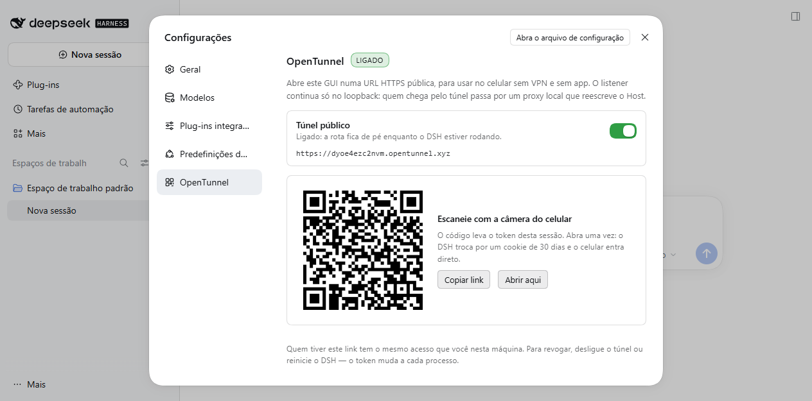

# dsh-opentunnel

Uma rota HTTPS pública para o GUI Web do DSH, ligada e desligada por um
interruptor em **Configurações → OpenTunnel**, com um QR code **permanente**
para entrar pelo celular. Sem VPN, sem app no telefone, sem abrir porta no
roteador.



## Como se usa

1. **Configurações → OpenTunnel** (no menu da conta, no pé da barra lateral).
2. Ligue **Túnel público**. Na primeira vez leva uns 30 s: o túnel é criado e o
   certificado é emitido por ACME. Da segunda vez anexa em segundos.
3. Aponte a câmera do celular para o QR. Ele abre
   `https://<host>/e/<código>`; o túnel troca esse código pelo token do processo
   atual e o DSH devolve um cookie assinado de 30 dias. Depois disso o celular
   entra direto, sem código.
4. Desligue o interruptor quando não precisar. A rota pública morre na hora.

O DSH também imprime o link no terminal, na mesma linha de boot:

```
dsh web: http://127.0.0.1:3080/?token=…
dsh opentunnel: https://tqeae3hifged.opentunnel.xyz/e/390abeb82886223d2c5dca1485769813
```

E grava o mesmo link em `$DSH_HOME/opentunnel-link.txt` (modo 600).

### Por que existe o `/e/<código>`

O token que o DSH imprime é **por processo**: reiniciar o DSH troca o token, mas
o hostname e o caminho continuam idênticos — então qualquer link salvo, favorito
ou QR antigo passa a responder `401 dsh web authentication required`, mesmo
parecendo a mesma URL.

O `/e/<código>` resolve isso: o código é gerado uma vez, fica em
`$DSH_HOME/opentunnel.json` e o proxy o troca pelo token vivo a cada abertura.
O link não muda quando o DSH reinicia. Ele só depende do hostname do túnel (que
também é estável, porque a identidade fica em
`%USERPROFILE%\.local\share\opentunnel\`) e do túnel estar ligado.

## Por que existe um proxy no meio

O DSH tranca o `/api` por um fence de `Host`/`Origin`: aceita loopback, o IP de
bind do listener e o que estiver em `trustedHosts` — que é valor de boot
(`--trusted-host`). O túnel entrega o `Host` do visitante intacto (medido), então
o fence responderia **403** em todo `/api` e o GUI carregaria sem back-end.

O plugin põe um proxy em loopback na frente do listener e aponta o túnel para
ele. O proxy reescreve `Host` e `Origin` para `127.0.0.1:<porta>` e deixa o
resto passar — inclusive `sec-fetch-site`, que é o que barra CSRF de verdade.
Resultado: o visitante parece o que é, uma requisição local, e **nenhuma flag é
necessária**.

Consequência a saber: o cookie fica preso a `127.0.0.1:<porta>`. Se você mudar a
porta do listener, os cookies antigos param de valer — mas o link permanente
continua funcionando e emite um novo.

## Instalação

No `package.json` do profile (`$DSH_HOME/profiles/web/package.json`):

```json
{
  "dependencies": {
    "@ikauann/dsh-opentunnel": "link:C:/caminho/para/dsh-opentunnel"
  },
  "dsh": {
    "profile": {
      "bundles": ["…", "@ikauann/dsh-opentunnel"]
    }
  }
}
```

Para instalar de um clone do repositório em vez de um `link:`, troque a
dependência por `"github:ikauann/dsh-opentunnel"` e mantenha a entrada em
`bundles` — o nome do pacote é o que a linha do bundle procura.

Depois instale e **reinicie** (o bundle de servidor e o módulo de cliente só
entram num boot novo):

```powershell
$env:DSH_HOME="$HOME\.dsh"
dsh plugin --profile web install
dsh --profile web
```

## Configuração

| chave | padrão | o que faz |
| --- | --- | --- |
| `enabled` | `true` | Estado **do primeiro boot**. Depois disso, quem manda é o interruptor. |
| `routeName` | `@` | `@` serve o hostname do túnel; um rótulo DNS serve `<rota>.<hostname>`. |
| `profile` | `dsh` | Nome do profile do OpenTunnel que guarda a identidade (token + chave + cert). |
| `api` | `""` | Control plane; vazio segue `$OPENTUNNEL_API`, depois `opentunnel.xyz`. |
| `proxy` | `""` | Proxy HTTP para control plane e bridge; vazio segue o ambiente. |
| `rewrite` | `true` | Proxy de reescrita. Desligar exige `--trusted-host <host do túnel>`. |
| `rewritePort` | `0` | Porta do proxy; `0` pede uma ao SO. |
| `targetPort` | `0` | Alvo do proxy; `0` lê a porta viva do listener. |
| `panelPath` | `/opentunnel` | Família de rotas que a página consome. |
| `linkFile` | `""` | Onde gravar o link permanente; vazio usa `$DSH_HOME/opentunnel-link.txt`. |
| `printLink` | `true` | Imprime o link no terminal quando a rota anexa. |
| `persist` | `true` | Guarda o interruptor **e o código de entrada** em `$DSH_HOME/opentunnel.json`. Desligado, o link muda a cada boot. |

### Rotas que a página usa

Todas exigem o header `x-dsh-opentunnel`, cujo valor o Host injeta no documento
(e só um documento autenticado carrega o index):

| rota | o que faz |
| --- | --- |
| `GET /opentunnel/state` | estado, URL, porta do proxy, erro |
| `POST /opentunnel/enable` | abre a rota |
| `POST /opentunnel/disable` | fecha a rota |
| `GET /opentunnel/link` | link permanente (409 enquanto não anexa) |
| `GET /opentunnel/qr` | o mesmo link como SVG de QR |

E, **atrás do proxy** (só pelo túnel, nunca no listener local):

| rota | o que faz |
| --- | --- |
| `GET /e/<código>` | 302 para `/?token=<token vivo>`; código errado responde 403 |

### Sem o proxy

Se preferir não ter o salto extra, desligue `rewrite` e suba o listener
confiando no host do túnel:

```powershell
dsh --profile web --trusted-host tqeae3hifged.opentunnel.xyz --public-url https://tqeae3hifged.opentunnel.xyz
```

`--public-url` só anuncia; `--trusted-host` é quem libera a autoridade no fence.
Sem proxy não existe `/e/<código>`: aí volte a usar o link com token que o DSH
imprime, que muda a cada reinício.

## Segurança

- Sem token e sem código, a URL pública responde **401** em tudo — medido.
- **O link permanente é uma credencial durável**, como uma senha: quem o tiver
  tem o agente inteiro, ou seja execução de código nesta máquina. Ele não expira
  com o processo (é justamente o ponto). Para revogar, apague a chave
  `entryCode` de `~/.dsh/opentunnel.json` e reinicie o DSH — um código novo é
  gerado e todos os links antigos morrem.
- O código tem 128 bits e nunca vai para o contexto do modelo: ele sai no
  terminal, no `opentunnel-link.txt` (modo 600) e na página de Configurações.
- O QR é renderizado no Host, atrás do token da página, e chega como SVG por
  fetch: o link não vira URL de `` que terceiros possam logar.
- O certificado HTTPS termina neste processo (é o TLS do OpenTunnel, chave
  privada nunca sai daqui); o relay não vê plaintext.
- Hostname de rota não aparece em Certificate Transparency, e `*.opentunnel.xyz`
  só resolve para túneis que existem.

## Limitações

- O CLI do OpenTunnel (Rust) só tem binário para Linux e macOS. No Windows este
  plugin usa o SDK TypeScript, que roda em Node — foi o caminho validado.
- Uma rota pertence a um bridge por vez: se outro cliente estiver na mesma rota,
  o SDK fica re-tentando e assume quando ela soltar.
- O túnel não autentica ninguém; quem autentica é o DSH (token vivo + cookie).

## Verificação

Duas provas, ambas contra um listener real e um túnel real:

```powershell
# Host: interruptor, guards, link permanente, porta /e/, fluxo do celular e WebSocket
$env:DSH_CLI_ROOT="$(npm root -g)\@deepseek-ai\dsh"
$env:XDG_DATA_HOME="$PWD\.data"   # identidade de teste em vez da sua
node --import ./test/loader.mjs test/smoke.mjs <token-do-DSH> <porta>

# Cliente: registro nos slots e primeira renderização da seção, sem DOM
node test/client.smoke.mjs
```

O `test/loader.mjs` existe só para o teste: resolve `@deepseek-ai/*` do install
global do CLI (`DSH_CLI_ROOT`), já que o repositório vive fora de um profile —
dentro de um profile esses pacotes resolvem sozinhos.
